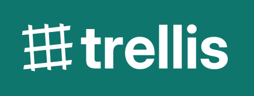
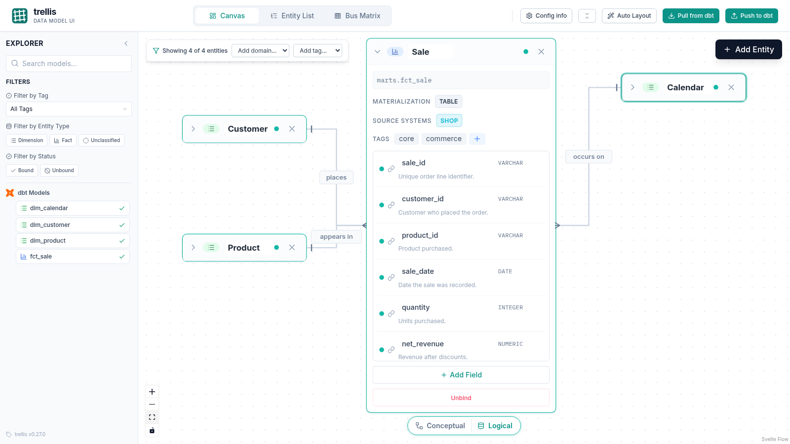

# trellis

<p align="center">
  
</p>

Trellis gives your dbt project a visual data model that connects business entities to the models, fields, and relationships in your warehouse. Work in a local canvas, keep the model in version-controlled YAML beside your dbt project, and sync descriptions, tags, and relationship tests with dbt.

## See it in action

<p align="center">
  <a href="https://github.com/user-attachments/assets/d30406c2-13e0-46aa-9288-a0414c6688cf">
    
  </a>
</p>

[Watch the walkthrough: create relationships and push them to dbt](https://github.com/user-attachments/assets/d30406c2-13e0-46aa-9288-a0414c6688cf).

## Why Trellis

ERDs and business definitions often live outside the dbt project, so they drift as models change. Trellis keeps the conceptual view and the logical details in the same model files, in the same repo as the transformations. Analysts can review the business structure without reading SQL, and developers can work with fields, types, and dbt metadata.

## Quick start

```bash
uv tool install trellis-datamodel
```

In your dbt project, generate the artifacts and start Trellis:

```bash
cd /path/to/your/dbt-project
dbt docs generate
trellis init
trellis run
```

Trellis opens at <http://localhost:8089>. `trellis init` creates `trellis.yml`; edit it to set your project and artifact paths.

## What you can do

- Switch between a **Conceptual** view of entities and relationships and a **Logical** view of fields, types, and materialization.
- Pull models and metadata from dbt, then push descriptions and tags back to your project.
- Draw relationships and generate dbt relationship tests from them.
- Optionally classify facts and dimensions, build a Bus Matrix, or document business events and processes.

## Examples and walkthroughs

| | |
| --- | --- |
| [Getting started](examples/1%20-%20Getting%20Started.md) | Initialize a project, edit entities, draw relationships, and push changes to dbt. |
| [dbt integration](examples/3%20-%20dbt%20integration.md) | Load dbt models, bind them to entities, and infer relationships from tests. |
| [Documenting business processes](examples/2%20-%20Documenting%20Business%20Processes.md) | Optional workflow for events, annotations, and processes. |

More narrative walkthroughs and context: [full tutorial](https://app.capacities.io/home/667ad256-ca68-4dfd-8231-e77d83127dcf) · [general information](https://app.capacities.io/home/8b7546f6-9028-4209-a383-c4a9ba9be42a).

## Configuration

After `trellis init`, edit **`trellis.yml`**. Annotated options and defaults live in **[trellis.yml.example](trellis.yml.example)** (paths, modeling style, optional lineage/exposures, entity guidance, prefixes, etc.).

You can also open **`/config`** in the app to edit settings in the browser (validated saves; see example file for field meanings).

### Landing page and Canvas defaults

Choose the page shown when opening the root URL, and optionally define shared Canvas filters:

```yaml
start_page: canvas  # or entity-list
canvas:
  default_filters:
    domains: []
    tags: []
```

`start_page` affects only `/`; explicit routes such as `/canvas` and `/entity-list` remain authoritative. Canvas defaults are project-wide settings stored in version-controlled `trellis.yml`, not personal preferences. They are applied once to an otherwise unfiltered Canvas session. Users can clear or change them while working; those session changes are reversible and are not written back to `trellis.yml`.

From Entity List, **Open filtered on Canvas** opens the complete current filtered result set on Canvas. An explicit Canvas URL entity filter takes precedence over project-wide domain and tag defaults.

### Apache Ossie export

Trellis can also write an [Apache Ossie](https://github.com/apache/ossie) semantic model. The feature is opt-in and beta:

```yaml
ossie:
  enabled: true
```

The document is written to `semantic_model.yml` beside `data_model.yml`. Set `ossie.file` to put it somewhere else (a relative path resolves against `dbt_project_path` when that is set, otherwise against the directory of `trellis.yml`), and `ossie.source.database` / `ossie.source.schema` to override the address segments the adapter reports (those reflect whatever target last ran dbt). Only entities bound to a model are exported: draft entities, and relationships that touch them, are skipped and listed as warnings in the Push response.

### Metric tree

The canvas answers what is in the warehouse. The metric tree answers why a number moved. It is beta and off by default:

```yaml
metrics:
  enabled: true
```

The `/metrics-tree` page holds two kinds of metric. A **draft metric** is authored in Trellis and carries a label, description and expression. A **bound metric** is a reference to a metric already defined in `semantic_model.yml`: it stores `{dataset, name}` and no copy of the definition, so the tree cannot drift from the semantic model. Draw an arrow from a node's right handle onto another node to record an influence from the driver to the metric it moves. An influence is a claim about direction, not a formula.

`metric_tree.yml` is written beside `data_model.yml` with the metrics and the influence edges, sorted so an unchanged graph saves byte for byte; node positions are computed deterministically from the tree hierarchy.

Set `metrics.file` to move it, and `metrics.expression_dialect` (`ANSI_SQL` by default) to pick the dialect label written onto emitted expressions. It is a label, not a parser: Trellis does not validate the SQL.

Pushing with `ossie.enabled: true` emits the drafts into the Ossie document: a draft whose `dataset_ref` names an exported dataset (for example `fct_sale`) lands under that dataset's `metrics`; one without, or naming a dataset that is not exported, lands at the document root. Metrics Trellis did not author are preserved at both levels, including their `custom_extensions` and `ai_context`. Turning the feature off stops the emission and leaves the existing `metric_tree.yml` untouched, but the push still preserves whatever metrics are already in the Ossie document.

## Contributing

Contributions welcome. Workflow, local dev, tests, and packaging: **[CONTRIBUTING.md](CONTRIBUTING.md)**. All contributors sign the CLA once per GitHub account—see **[CLA.md](CLA.md)** and the bot on your PR.

## Acknowledgments

- [dbt-colibri](https://github.com/dbt-labs/dbt-colibri) for lineage-related capabilities that support trellis visualization.

## License

trellis Datamodel is licensed under the **[GNU Affero General Public License v3.0](LICENSE)**. See **[NOTICE](NOTICE)** for a short summary of copyright and licensing.
